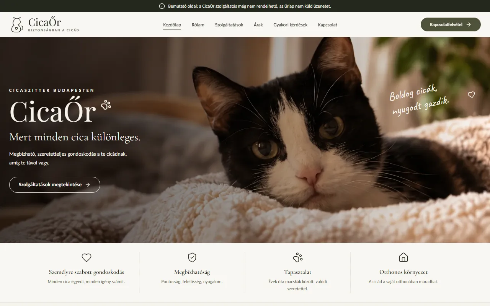
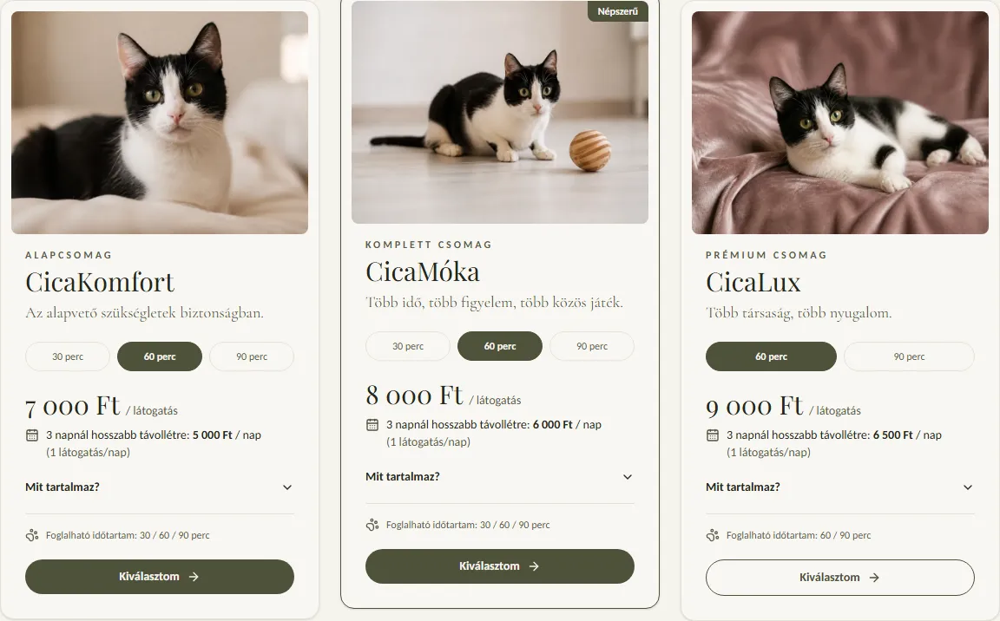
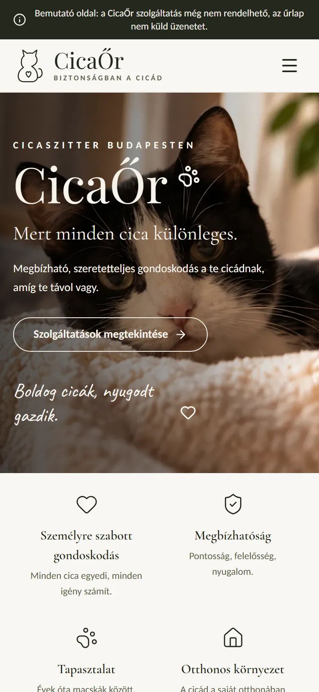
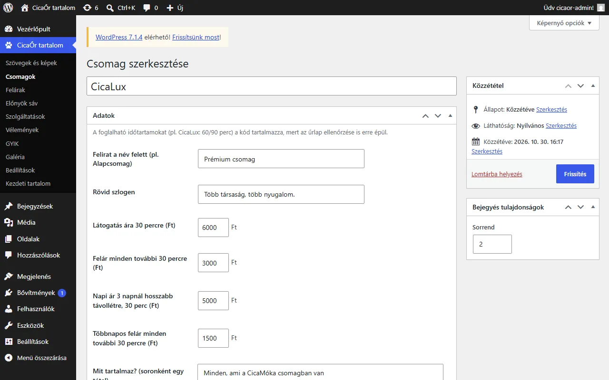
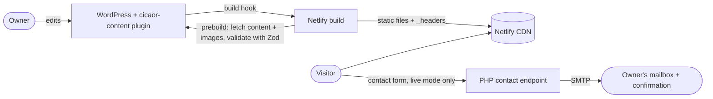
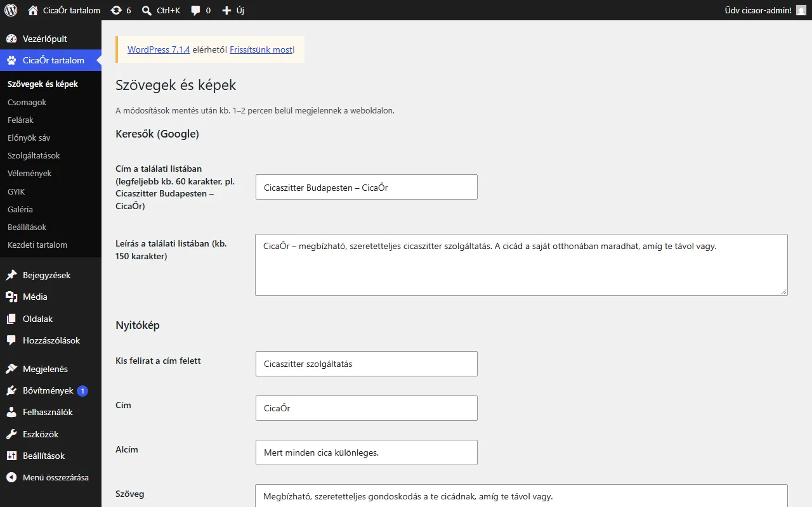

# CicaŐr – cat sitting website

A website for CicaŐr, a cat sitting service in Budapest: the sitter visits cats in their own home while the owners are away. The business has not launched yet, so the site currently runs in **demo mode**: it looks and works like the real thing, but nothing can be booked and the contact form sends nothing.

**Live demo:** https://cicaor.netlify.app · Built by [GABENIX](https://gabenix.hu)



| Pricing with live duration switch | Mobile | WordPress admin |
| --- | --- | --- |
|  |  |  |

## Highlights

- **Static Next.js 16 site** (App Router, TypeScript strict, Tailwind CSS v4), exported to plain files and served from Netlify's CDN.
- **Headless WordPress** with a purpose-built plugin: the owner edits prices, packages, add-ons, FAQ, reviews, texts and images in a familiar admin, and saving triggers a rebuild. The site never calls WordPress at runtime.
- **One validated contract** between CMS and site: a Zod schema checks every build's content, so a bad edit fails the build instead of breaking the page, and the previous deploy stays live.
- **PHP contact backend** with server-side validation mirroring the Zod schema, honeypot, per-IP rate limiting, and HTML e-mails over SMTP (PHPMailer) with a plain-text alternative.
- **Demo/live switch** (`NEXT_PUBLIC_SITE_MODE`): the demo shows a banner, keeps the form local, asks search engines not to index it and replaces the legal pages with an honest notice.
- **Security by default:** CSP and other security headers, production env validation, escaped e-mail templates and JSON-LD, a hardened CMS (no XML-RPC, no public user list, role-limited editing, build hook URL allow-list).
- **SEO and accessibility:** metadata, canonical URLs, Open Graph, sitemap, `LocalBusiness` JSON-LD (live mode), semantic headings, skip link, visible focus, labelled form errors, at least 12px text.
- **Tests** for the pricing logic, the content schema, the CMS image handling, the security headers and env checks (Vitest), and for the PHP validation, e-mail templates and rate limiting.

## Architecture



| Folder | What it is |
| --- | --- |
| `frontend/` | Next.js static export. Copy lives in `src/content/` (`hu.ts` for interface text, `site-content.json` for the CMS-owned content), features in `src/features/`. |
| `backend/` | Plain PHP contact endpoint (`contact.php`) with validation, rate limiting and mail templates. |
| `cms/` | The `cicaor-content` WordPress plugin and `bundle.php`, which packages it as an uploadable zip with the current content as seed. |

## Getting started

Requirements: Node.js LTS with npm, PHP 8.1+ (tested with 8.3) and Composer.

### Frontend

```bash
cd frontend
npm install
cp .env.example .env.local
npm run dev        # http://localhost:3000
npm run build      # static site in frontend/out
npm test           # Vitest
npm run lint
npm run typecheck
```

| Variable | Purpose |
| --- | --- |
| `NEXT_PUBLIC_SITE_MODE` | `live` turns the real site on. Anything else, including unset, builds the demo. |
| `SITE_URL` | Public origin, e.g. `https://cicaor.hu`. Used for canonical URLs, the sitemap, `robots.txt`, Open Graph and JSON-LD. Defaults to `http://localhost:3000`. |
| `NEXT_PUBLIC_CONTACT_API_URL` | Full URL of `backend/contact.php` (live mode). Falls back to `/backend/contact.php`. It is public by design (inlined at build time), so never put secrets in it. |
| `CMS_URL` | Base URL of the WordPress CMS, e.g. `https://cms.example.hu`. Build-time only. Without it the build uses the committed content snapshot. |

On Netlify's production build (`CONTEXT=production`) the build stops when a required value is missing or not `https` (`src/lib/build-env.ts`): the demo needs `SITE_URL`, the live site also `NEXT_PUBLIC_CONTACT_API_URL` and `CMS_URL`. After the build, `scripts/postbuild.mts` writes `out/_headers` with the security headers; the CSP allows fetches only to the contact backend's origin (none in the demo).

### Content (WordPress CMS)

1. Editors change texts, prices, add-ons, FAQ, reviews and images in WordPress (menu "CicaŐr tartalom"). Only Editors and Administrators can.
2. Saving schedules a Netlify build hook call one minute later, so a series of edits triggers one build.
3. Before every build, `npm run prebuild` (`scripts/pull-cms-content.mts`) fetches `?rest_route=/cicaor/v1/content`, downloads the images into `public/cms/` (resized WebP), validates everything against `src/content/site-content-schema.ts` and writes `src/content/site-content.json`.
4. Invalid or incomplete content fails the build, and Netlify keeps serving the previous deploy.

Package ids (`komfort`, `moka`, `lux`) and their bookable durations stay in code, because the contact form validation depends on them.



```bash
php cms/bundle.php                                    # cms/dist/cicaor-content.zip with the current content as seed
CMS_URL=https://cms.example.hu npm run cms:pull       # refresh the snapshot locally (from frontend/), then commit it
```

Setting up a new WordPress: install WordPress (PHP 8.3+), upload `cicaor-content.zip` under Plugins → Add New → Upload Plugin, activate it, and use "CicaŐr tartalom → Kezdeti tartalom" once. Under "Beállítások" set the website URL (visitors of the CMS front end are redirected there) and the Netlify build hook. Then set `CMS_URL` in the Netlify environment variables.

### Backend

```bash
cd backend
composer install
cp .env.example .env     # then edit the values
php tests/validation-test.php
php tests/mail-template-test.php
php tests/rate-limit-test.php
```

Every enquiry sends two HTML mails (with a plain-text alternative) through SMTP: a notification to `MAIL_TO` and a confirmation to the visitor. The confirmation never repeats the visitor's message, because anyone can type someone else's address into the form.

| Variable | Purpose |
| --- | --- |
| `MAIL_DRIVER` | `smtp` sends real mail, `log` writes it to `storage/mail.log` plus an `.html` preview per mail type (development) |
| `MAIL_TO` / `MAIL_FROM` / `MAIL_FROM_NAME` | Recipient, sender address and sender name |
| `SMTP_HOST` / `SMTP_PORT` / `SMTP_ENCRYPTION` | SMTP server; `587` with `tls` (STARTTLS) or `465` with `ssl` |
| `SMTP_USERNAME` / `SMTP_PASSWORD` | SMTP login of the sending mailbox |
| `ALLOWED_ORIGINS` | Comma separated origins allowed by CORS, e.g. `https://your-site.example` |
| `RATE_LIMIT_MAX` / `RATE_LIMIT_WINDOW_SECONDS` | Requests allowed per IP per window |

Never commit `.env`.

## Going live (checklist)

1. Fill in every `[TODO: …]` in `frontend/src/content/legal-hu.ts` and have both legal texts reviewed by a lawyer.
2. Set `NEXT_PUBLIC_SITE_MODE=live`, `SITE_URL`, `NEXT_PUBLIC_CONTACT_API_URL` and `CMS_URL` in Netlify's environment variables and let Netlify build from git.
3. Host `backend/` on a PHP server (Netlify cannot run PHP), run `composer install --no-dev` there, and make sure `.env`, `composer.*`, `src/`, `templates/`, `tests/`, `vendor/` and `storage/` are not publicly readable (the `.htaccess` files cover Apache).
4. Set `ALLOWED_ORIGINS` to the exact production origin and `MAIL_DRIVER=smtp` with the SMTP values; configure SPF/DKIM/DMARC for the sending domain. `MAIL_FROM` must be the mailbox the SMTP login belongs to.
5. Upload the missing photos in the CMS (about, gallery), add real reviews and the social links.
6. Run `npm test`, `npm run lint`, `npm run build`, `npm audit` and `composer audit`.

## Decisions

- **Typed content file instead of `next-intl`:** the site is Hungarian only, so a typed dictionary avoids an extra dependency. It can be migrated to `next-intl` if more languages are needed.
- **Headless WordPress, fetched at build time:** the owner wanted a familiar admin interface on the PHP hosting the contact backend needs anyway. Fetching at build time keeps the site static and fast, and the site keeps working when WordPress is down. Images are copied into the build, so the CMS host serves no public traffic.
- **Own small plugin instead of ACF:** the free ACF has no repeaters or options pages, and a plugin with plain meta boxes has no paid dependency and exposes exactly one read-only endpoint.
- **Plain PHP endpoint instead of Laravel:** one form does not justify a framework.
- **URL parameters for the chosen package:** "Kiválasztom" links to `/?csomag=<id>&ido=<minutes>#kapcsolat`, which pre-fills the form, survives a reload and needs no shared client state. The values are validated against the known packages before use.
- **CSP with `'unsafe-inline'` scripts:** a static export inlines its boot scripts and cannot use per-request nonces. The policy still blocks foreign scripts, framing, plugins and requests to any other host.
- **Prefetch file repair after Windows builds:** Next.js 16 names segment prefetch files with `path.relative()`, so a Windows export nests them in folders the browser never asks for. `scripts/segment-files.ts` adds the expected flat copies; on Linux it finds nothing to do.
- **Demo mode by default:** the site cannot accidentally go live as a bookable service before the business and its legal texts are ready.
- **Light theme only:** the design is light. Dark tokens exist behind `data-theme="dark"` but nothing toggles them yet.
- **Zod on the frontend and manual checks in PHP:** rules are mirrored by hand in `schema.ts` and `validation.php`; keep them in sync.

## License

All rights reserved. The code is published for portfolio purposes; please do not reuse it without permission.
